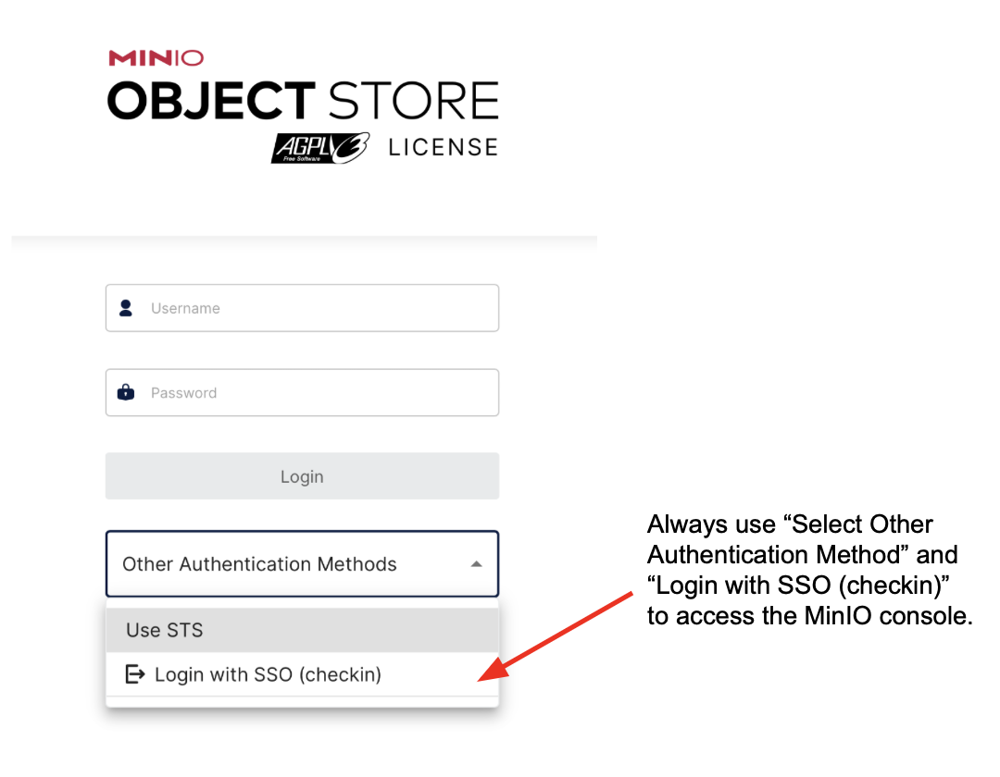
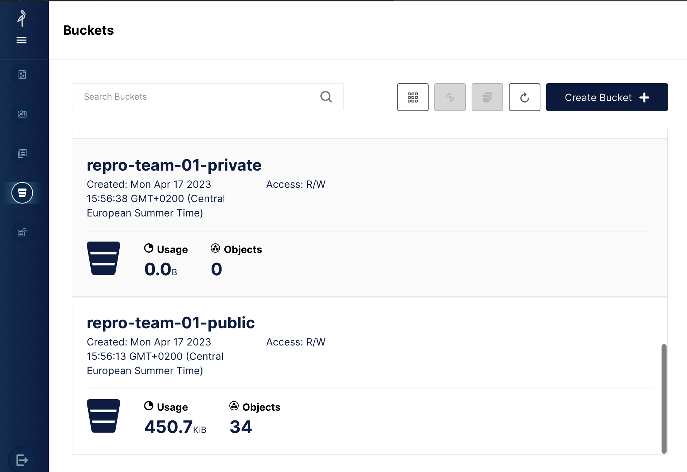

# Registration to Pangeo@EOSC

As explained in the previous section, Pangeo@EOSC is the main public deployment of the Pangeo ecosystem open to European researchers and their collaborators.
The deployment is hosted on European infrastructure and is meant to remain public and freely accessible to all European researchers. Pangeo@Europe mostly uses Pangeo@EOSC for training researchers.

In this section you will learn how to register and access pangeo@eosc services, and how to start the workshop environment with a single click.

You need to create an [EGI Check-in account](https://www.egi.eu/service/check-in/) and enroll to the `vo.pangeo.eu` Virtual Organisation. There are several steps to follow:

1. **Sign up** for an EGI Check-in account following [these steps](https://docs.egi.eu/users/aai/check-in/signup/). **Using [ORCID iD](https://orcid.org/) to authenticate is recommended.**
2. **Enroll** in the `vo.pangeo.eu` Virtual Organisation (VO) by clicking on [the enrollment URL](https://aai.egi.eu/auth/realms/id/account/#/enroll?groupPath=/vo.pangeo.eu) using the EGI Check-in account created in the previous step. In the **"reason to join"** field, please write exactly:

   ```text
   Attend the pangeo-fish workshop at the ETN Symposium 2026 in Copenhagen
   ```

   Using this exact text lets us identify workshop participants and approve the requests as soon as possible. Review and click on `Submit`.

:::{warning}
The approval of your enrollment to the VO is done **manually**. Please register **as early as possible before the workshop** (ideally a few days before), otherwise you may not be able to log in during the session.
:::

:::{note}
After the **ETN Symposium 2026 pangeo-fish workshop**, you can continue to use the resources.
We would appreciate you get in touch with us to give us some feedback and be informed of the platform evolution. You can do this through [Github Discussions](https://github.com/pangeo-data/pangeo-eosc/discussions).

You can also contribute to "the Pangeo show and tell" online meetups.
:::

## Start the workshop environment (one click)

Once your enrollment has been approved, click on the link below. It will:

1. ask you to **Sign in with EGI Check-in** (use the same ORCID iD / EGI account as above),
2. start a JupyterLab server with the **pangeo-fish Docker image** (`ghcr.io/tinaok/pangeo-fish-notebook:2026.06.04-10751a5`),
3. **clone this repository** (`pangeo-fish-etn2026`) into your home directory (or update it if it is already there) and open the pangeo-fish notebook.

👉 **<a href="https://pangeo-eosc.vm.fedcloud.eu/hub/spawn?profile=only-choice&amp;profile-option-only-choice--image--unlisted-choice=ghcr.io%2Ftinaok%2Fpangeo-fish-notebook%3A2026.06.04-10751a5&amp;next=%2Fhub%2Fuser-redirect%2Fgit-pull%3Frepo%3Dhttps%253A%252F%252Fgithub.com%252Fpangeo-fish%252Fpangeo-fish-etn2026%26urlpath%3Dlab%252Ftree%252Fpangeo-fish-etn2026%252Fdocs%252Fpangeo-fish.ipynb%26branch%3Dmain">Start the ETN 2026 pangeo-fish workshop environment</a>** 👈

or copy and paste this URL into your browser's address bar:

```
https://pangeo-eosc.vm.fedcloud.eu/hub/spawn?profile=only-choice&profile-option-only-choice--image--unlisted-choice=ghcr.io%2Ftinaok%2Fpangeo-fish-notebook%3A2026.06.04-10751a5&next=%2Fhub%2Fuser-redirect%2Fgit-pull%3Frepo%3Dhttps%253A%252F%252Fgithub.com%252Fpangeo-fish%252Fpangeo-fish-etn2026%26urlpath%3Dlab%252Ftree%252Fpangeo-fish-etn2026%252Fdocs%252Fpangeo-fish.ipynb%26branch%3Dmain
```

:::{note}
If a JupyterLab server is **already running** for you (for example with another image), the link above opens that server instead of starting a new one with the pangeo-fish image. In that case, stop it first: in JupyterLab, go to `File > Hub Control Panel`, click `Stop My Server`, then click the link again.
:::

The 🚀 (rocket) button at the top of every notebook page of this book does the same thing (clone/update the repository and open that notebook) with the `JupyterHub` entry, but it does **not** select the Docker image for you.

## Access to Pangeo@EOSC manually

You can also access Pangeo@EOSC via [https://pangeo-eosc.vm.fedcloud.eu/](https://pangeo-eosc.vm.fedcloud.eu/). Click on `Sign in with EGI Check-in` and then use your ORCID iD credentials.

In the server options, under **Image**, choose **"Specify an existing docker image"** (custom image) and enter:

```
ghcr.io/tinaok/pangeo-fish-notebook:2026.06.04-10751a5
```

The fixed tag `2026.06.04-10751a5` contains the Pangeo-Fish version prepared for this workshop. Use this fixed tag so that everybody runs the same environment. The image is built and tested by [tinaok/pangeo-fish-docker](https://github.com/tinaok/pangeo-fish-docker).

Once JupyterLab is started, open a terminal and clone this repository:

```
git clone https://github.com/pangeo-fish/pangeo-fish-etn2026.git
```

or use the one-click link of the previous section.

## Which kernel to use

The Docker image provides two Python kernels. **Use "Python (pangeo-fish)" for all the notebooks of this workshop** (it is selected automatically when you open them from this repository). The other kernel, "Python 3 (ipykernel)", is the standard Pangeo notebook environment without pangeo-fish.

In a terminal, the pangeo-fish environment is activated with `conda activate pangeo-fish`.

A few practical JupyterLab tips (running all cells, shutting down kernels, stopping your server, deleting folders) are gathered in {doc}`jupyterlab-basics`.

## Copernicus Marine credentials

Both notebooks download ocean model data (GLORYS, Global Ocean Physics Reanalysis) from the [Copernicus Marine Service](https://data.marine.copernicus.eu/). You need a (free) Copernicus Marine account:

1. Go to [https://data.marine.copernicus.eu/register](https://data.marine.copernicus.eu/register) and create an account (an email address is enough; confirm it by clicking on the link you receive).
2. Remember your **username** (often your email address) and **password**.
3. The first notebook asks for them once (`copernicusmarine.login()`) and stores them in `~/.copernicusmarine/.copernicusmarine-credentials` in your home directory on Pangeo@EOSC, which is persistent. You will not be asked again.

Please create the account **before the workshop**: the confirmation email can take a few minutes to arrive.

## Resources

Currently (September 2023) Pangeo@EOSC is configured to host 20 simultaneous users with Jupyter (8 CPUs, 32GB RAM) and a Dask cluster (max: 4 workers, each worker with 8 CPUs and 32 GB RAM). This is subject to change depending on usage and resource availability at CESNET.

A [Dask Gateway](https://gateway.dask.org/) is available for scaling your computation. For more details on this deployment, you may want to take a look at [Daskhub helm chart](https://github.com/dask/helm-chart/tree/main/daskhub).

## Access MinIO

Each user has a very small amount of local storage when using the DaskHub as it is not meant to be used for storing large data.  Instead a dedicated [MinIO Object storage](https://min.io) has been setup.

The MinIO console endpoint is: [https://pangeo-eosc-minio.vm.fedcloud.eu/](https://pangeo-eosc-minio.vm.fedcloud.eu/). You can authenticate to the MinIO Object Storage in the same way you login to DaskHub. As shown on the Figure below, make sure you "Select Other Authentication Method" and "Login with SSO (checkin)" to access the MinIO console. Then use your ORCID iD to login.



You can create, access and manage your buckets from the minIO console (or use [minIO Python package](https://min.io/docs/minio/linux/developers/python/minio-py.html)). The figure below shows the GUI (with several tabs on the left; the bucket tab is selected on the figure): initially, you won't have any buckets so please feel free to create public/privates buckets.



In addition to the MinIO console, the API end point is `https://pangeo-eosc-minioapi.vm.fedcloud.eu/` for those who prefer to interact with MinIO via the API.

## Support

If you need support, please open an [issue](https://github.com/pangeo-fish/pangeo-fish-etn2026/issues).

Please include the output of the last cell of the Pangeo-Fish notebook (appendix **Information for bug reports**): it shows which Docker image, Pangeo-Fish commit and notebook version you used.
